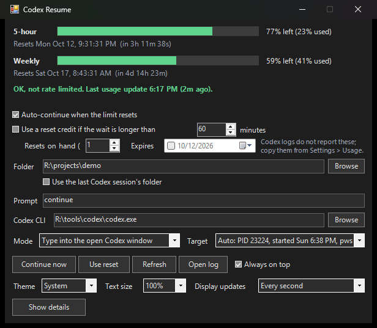

# Codex Resume

Tiny Windows tray app that watches your Codex CLI usage windows and resumes your last Codex session once the 5-hour (or weekly) limit resets.

- Reads the `rate_limits` events Codex CLI writes to `%USERPROFILE%\.codex\sessions\**\*.jsonl` (or `$env:CODEX_HOME\sessions`).
- Settings and log live in `%APPDATA%\CodexResume\`.

## Run

Double-click `Start-CodexResume.cmd` (launches `CodexResume.ps1` hidden via Windows PowerShell 5.1+).
