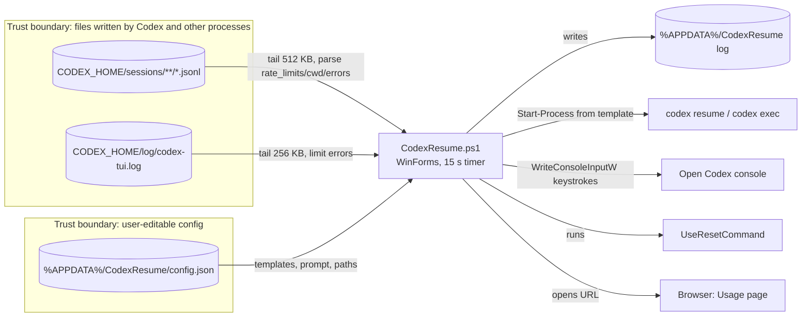

# Phase 02: Architecture & Design (retroactive)

Project: CodexResume · Date: 2026-10-12 · Lead: main session (retroactive description of the shipped design) · Status: retroactive

## Objective
Describe the shipped architecture and its trust boundaries, so the phase 7 audit has a model to test against.

## Key Activities
- [SEC] Data flow and trust boundaries (below); threat model rows in `docs/security/threat-register.md`.
- [SEC] No authentication, sessions, or encryption: there is no remote party. Secrets: the app stores none. `UseResetCommand` is a user-written command that the app runs.
- [PRIV] Data flow: everything is local; see the diagram.
- [UX] A single WinForms window plus a tray icon; light, dark, and high-contrast palettes; text scaling from 100% to 200%.
- API contract: not applicable. There is no API; the only interface is the Codex CLI's on-disk JSONL format, which is undocumented and changes over time.

## Deliverables
| Deliverable | Path / link | Priority it serves |
|---|---|---|
| Data flow diagram with trust boundaries | this record | SEC / PRIV |
| Threat register | `docs/security/threat-register.md` | SEC |

## Tools/Best Practices
| Tool or standard | Used for | Priority |
|---|---|---|
| STRIDE per data flow | Boundary review | SEC |
| Mermaid | Diagram | SEC / PRIV |

## Reasoning

### 1. Security (paramount)
There are two inbound trust boundaries:
- TB1: session and log files. Their content is partly model-generated, so it must be treated as untrusted. Every string taken from them (cwd, session id, timestamps) is a candidate for injection into the commands the app starts.
- TB2: the config file. It is written by the user, but also by any process running as that user. Running `UseResetCommand` from it is by design: it is a user-supplied hook, and anything that can write the config could already run code as the user.

The outbound actions (starting processes, injecting keystrokes) are where an error turns into code execution. Phase 7 tests each of them.

### 2. Privacy
No data crosses the machine boundary except one action: opening the public Usage page in the browser, which the user triggers. Transcripts are read but should never be persisted again. The only files the app writes are its own log and config.

### 3. UI/UX
Status comes from a 15-second poll of the files. The UI cannot know about a Codex event until Codex writes it and the app reads it, so the age of the data has to be visible to the user.

### Trade-offs
The app relies on the undocumented file format and file timestamps written by Codex. Correctness (security) takes priority over simplicity, so the stale-timestamp fix ranks data by the timestamps inside the files, not by file metadata.

## Summary/Conclusions
The architecture is a single process with local-only flows. The threat model covers TB1 and TB2, and phase 7 verifies the mitigations. There is no API to freeze.

## Exit Gate
- [x] [SEC] Threat model covers every trust boundary with a mitigation or accepted risk (mitigations verified in phase 7)
- [ ] [SEC] `security-reviewer` signed off on auth, secrets, and encryption design (no auth or crypto in the app; covered by the phase 7 audit)
- [ ] [PRIV] Data flow shows storage, processors, retention, deletion path; `privacy-reviewer` signed off (phase 7)
- [ ] [UX] Wireframes for top journeys include all interaction states; `ux-reviewer` signed off (phase 7, against the built UI)
- [x] API contract frozen and linted: not applicable (no API)
- [ ] User approved architecture
