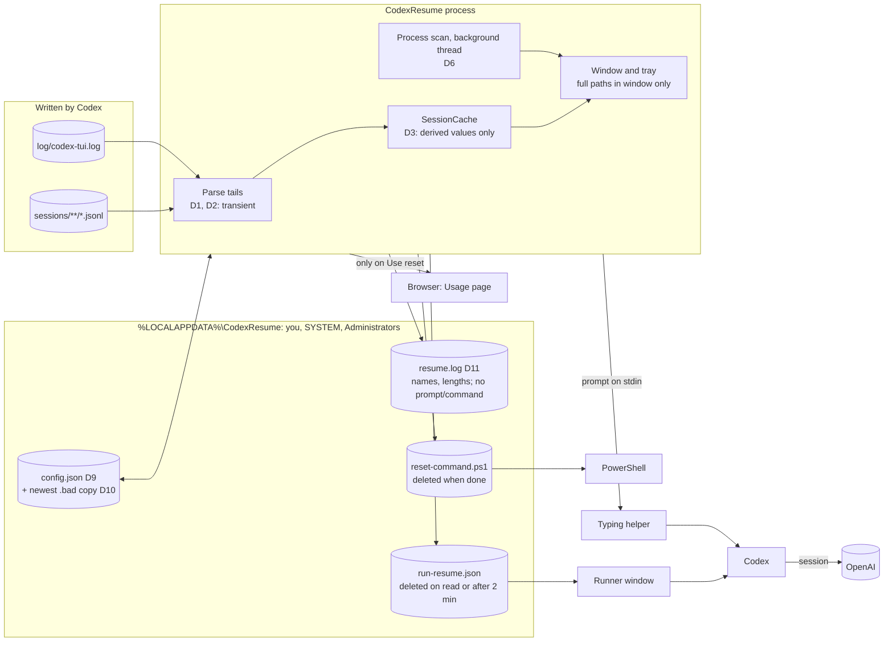

# Data Flow: CodexResume v1.1

Item numbers (D1 to D14) refer to `data-inventory.md`.

- **Stays in memory only:** transcript text (D1, D2) and the process list (D6).
- **Written to disk:** the config, the log, and two short-lived files (the runner data and the reset script). All of them are in `%LOCALAPPDATA%`, which only your account, SYSTEM and Administrators can open.
- **Leaves the machine:** only what Codex sends to OpenAI on resume, and the browser request when the user presses **Use reset**.
- **Deletion:** remove the folder. Codex's own files are never changed.
